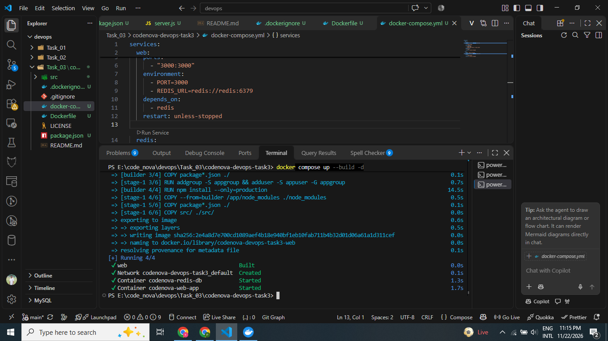
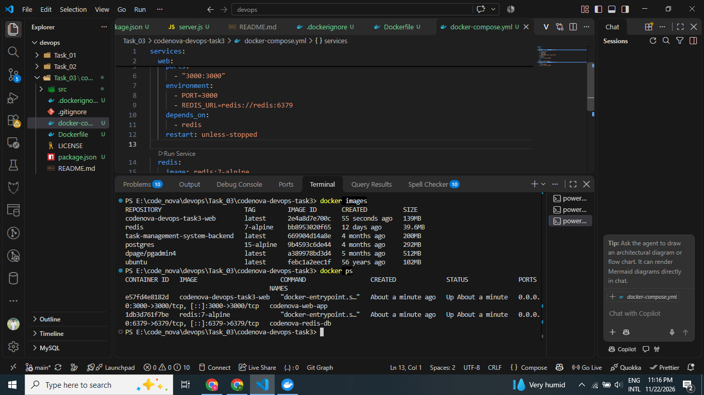
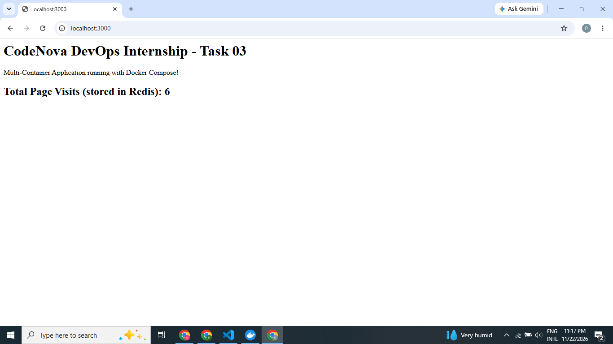

# CodeNova DevOps Internship - Task 03: Multi-Container Application with Docker Compose

This repository demonstrates containerizing a Node.js web application alongside a Redis in-memory database using **Docker** and **Docker Compose**, adhering to production security and image optimization best practices.

---

## 🏗️ Architecture & Best Practices

* **Multi-Stage `Dockerfile`:** Separates dependency installation from the final runtime image using `node:20-alpine` to keep the image size minimal (~135MB).
* **Container Security (Non-Root User):** Configures a dedicated `appuser` inside the container instead of running processes as `root`.
* **Clean Build Context (`.dockerignore`):** Excludes `node_modules`, `.git`, and local environment files from the Docker build context.
* **Service Orchestration (`docker-compose.yml`):** Connects the `web` service (Express.js) and `redis` database service (`redis:7-alpine`) over an isolated bridge network.

---

## 📁 Project Structure

```text
codenova-devops-task3/
├── src/
│   └── server.js           # Node.js Express web application
├── .dockerignore           # Files excluded from Docker build context
├── .gitignore              # Ignored Git files
├── docker-compose.yml      # Multi-container orchestration config
├── Dockerfile              # Multi-stage optimized Docker build file
├── LICENSE                 # MIT License
├── package.json            # Application dependencies
└── README.md               # Setup instructions & documentation

---

## 📸 Execution Screenshots

### 1. Successful Docker Compose Build


2. Image Size Inspection & Running Containers


### 3. Running Web Application with Redis Counter
